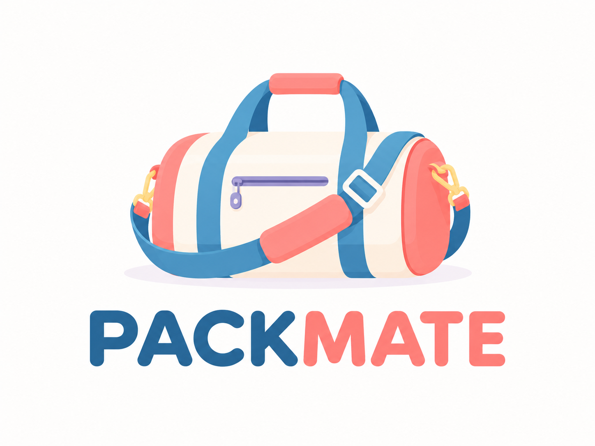

# PACKMATE



**PACKMATE**는 여행·출장·교육·개인 일정에 맞춰 준비물을 추천하고, 체크 상태와 누락 이력을 관리하는 정적 웹앱입니다. 일정의 목적과 지역, 활동, 기간, 사용자가 선택한 예상 날씨를 반영해 준비 목록을 구성하여 필요한 물건을 빠뜨리는 일을 줄이는 것을 목표로 합니다.

- **GitHub 저장소:** [Deumy316/packmate](https://github.com/Deumy316/packmate)
- **서비스:** [https://deumy316.github.io/packmate/](https://deumy316.github.io/packmate/)
- **현재 상태:** 배포 전 정적 검증 단계입니다. JavaScript 문법과 `index.html`의 로컬 파일 경로는 확인했으며, 이번 변경의 GitHub Pages 배포와 출발 전 팝업 반복 방지는 별도 브라우저 확인이 필요합니다.

## 주요 기능

### 일정 만들기

- 여행·휴가, 출장·업무, 교육·행사, 방문·개인 일정 중 목적을 선택합니다.
- 국내 지역 또는 해외 국가와 도시를 선택하거나 직접 입력할 수 있습니다. 해외 국가와 도시는 코드에 등록된 선택 목록을 제공하며, 목록 밖의 이름도 입력할 수 있습니다.
- 일정 이름, 세부 목적, 숙박 여부, 기간, 시작일, 이동수단을 입력합니다. 종료일은 시작일과 숙박 기간을 바탕으로 계산됩니다.
- 활동을 검색해 여러 개 선택하거나 사용자 지정 활동을 등록·수정·삭제할 수 있습니다.
- 활동마다 준비물을 추가·수정·삭제해 해당 활동의 추천 준비물로 저장할 수 있습니다.

### 준비 목록과 체크리스트

- 일정 목적, 지역, 활동, 숙박 기간과 사용자가 고른 예상 날씨에 따라 준비물과 출발 전 할 일을 구성합니다.
- 예상 날씨는 실시간 예보가 아니라 사용자가 직접 선택하는 조건입니다. 날씨별 준비물 규칙과 일정 기간별 수량을 반영합니다.
- 준비물 수량을 `−` / `+` 버튼 또는 숫자 입력으로 조정할 수 있으며 수량과 단위는 일정 데이터에 저장됩니다.
- 준비물을 체크하고, 직접 추가·수정·삭제할 수 있습니다. 체크 상태는 저장되어 일정 화면에 다시 표시됩니다.
- 준비물을 개인 필수품으로 저장하면 이후 새 일정에 재사용할 수 있습니다.
- 빠뜨린 준비물을 누락 기록으로 남길 수 있습니다. 기록은 해당 일정에 보관되고 다음 일정의 준비 목록에도 우선 확인 항목으로 반영됩니다.
- 준비물은 카테고리별로 표시하며 전체·미완료·완료 필터와 카테고리 접기·펼치기를 제공합니다.
- 일정 상세 화면에서 준비물과 출발 전 할 일의 진행률을 확인할 수 있습니다.
- 화면 폭에 맞춰 배치가 바뀌는 반응형 UI와 맨 위·맨 아래 이동 버튼을 제공합니다.

### 저장된 일정

- 비로그인 상태에서는 일정을 현재 브라우저의 `localStorage`에 저장하고 다시 열 수 있습니다.
- 로그인 상태에서는 Supabase 인증 계정별 클라우드 일정만 표시하며, 일정 생성·수정·삭제와 체크리스트 변경을 클라우드에 저장합니다.
- 계정 변경과 로그아웃 시 이전 계정의 화면 데이터와 메모리 캐시를 제거하고, 클라우드 조회 실패 시 로컬 일정으로 대체하지 않습니다.
- 일정 수정 시 기존 일정 ID와 체크 상태, 수량 등 기존 목록 데이터를 가능한 범위에서 보존합니다.

### 계정·클라우드와 다국어

- Supabase 이메일 인증을 통해 로그인·회원가입·로그아웃 기능을 제공합니다.
- 클라우드 일정은 사용자 ID와 revision을 확인해 생성·수정·삭제하며, 충돌이나 결과가 불명확한 저장을 자동 재시도하지 않습니다.
- 한국어·English·Tagalog를 지원하며 선택한 언어는 `packmate.language.v1`에 저장됩니다.
- 과거 누락 준비물을 다음 일정 상단에 표시하고, 출발 전날 또는 당일에는 일정별 알림 팝업을 표시하도록 구현되어 있습니다. 팝업 반복 방지는 배포 전 브라우저에서 추가 확인해야 합니다.

## 실행 방법

### GitHub Pages

배포된 앱은 [https://deumy316.github.io/packmate/](https://deumy316.github.io/packmate/)에서 사용할 수 있습니다.

### 로컬 정적 서버

저장소를 내려받거나 복사한 뒤 프로젝트 루트에서 정적 서버를 실행합니다. 빌드나 패키지 설치는 필요하지 않습니다.

Python이 설치된 환경에서는 다음 명령 중 하나를 사용할 수 있습니다.

```bash
python3 -m http.server 8000
```

Windows에서 `py` 실행기가 설정된 경우:

```powershell
py -m http.server 8000
```

그다음 브라우저에서 [http://localhost:8000](http://localhost:8000)에 접속합니다. `file://`로 직접 여는 경우 브라우저별 저장 공간·보안 정책에 차이가 있을 수 있으므로 정적 서버 사용을 권장합니다.

## 기술 구성

- **HTML, CSS, JavaScript:** 빌드 단계 없이 브라우저에서 실행하는 정적 웹앱
- **Supabase:** 이메일 인증과 로그인 계정별 일정 저장
- **localStorage:** 비로그인 일정, 개인 필수품, 활동 설정, 초안, 언어 및 UI 상태 저장
- **외부 API:** 일정·준비물 추천 기능에 별도 유료 API나 서버가 필요하지 않습니다. 날씨 추천은 사용자가 선택한 예상 날씨에 기반하며 실제 날씨를 조회하지 않습니다.
- **외부 라이브러리:** 인증과 클라우드 데이터 처리를 위해 Supabase JavaScript SDK 2.x를 CDN에서 불러옵니다.
- **웹 글꼴:** `index.html`에서 Google Fonts를 선택적으로 요청합니다. 네트워크에서 글꼴을 불러오지 못하면 CSS 대체 글꼴을 사용합니다.

### 실행 파일 구조

| 경로 | 역할 |
| --- | --- |
| `index.html` | 정적 화면과 CSS·JavaScript 로드 순서 |
| `css/` | 기본 화면, 보완 UI, 인증·다국어·클라우드 이전 스타일 |
| `js/core/` | 앱 상태, 추천 엔진과 핵심 화면 연결 |
| `js/auth/` | Supabase 인증, 계정 상태와 계정별 일정 조회 |
| `js/integrations/` | Supabase 설정·클라우드 쓰기·이전·비교와 저장 보호 |
| `js/trips/` | 일정 폼, 활동, 생성·수정·삭제와 로컬 저장 |
| `js/checklist/` | 체크·수량·준비물·할 일·누락 기록과 체크리스트 UI |
| `js/i18n/` | 한국어·영어·타갈로그어 번역 적용 |

실행 파일은 `index.html`에 직접 연결되거나 인증 모듈에서 동적으로 불러옵니다. 디렉터리 구조와 상대 경로를 함께 유지해야 합니다.

## 저장 데이터와 제한 사항

브라우저 저장 호환성과 비로그인 기능은 다음 localStorage 키를 사용합니다. 비로그인 신규 일정은 `packmate.trips.v1`에 저장되지만 체험 중 활동 설정은 메모리에서만 유지될 수 있습니다. 로그인 계정의 일정은 Supabase `user_trips`에서 계정별로 조회·저장하며 공용 localStorage 일정으로 대체하지 않습니다.

| 키 | 저장 내용 |
| --- | --- |
| `packmate.trips.v1` | 저장한 일정, 준비물·할 일, 체크 상태, 수량, 날씨 선택 및 누락 기록 |
| `packmate.essentials.v1` | 이후 일정에 재사용할 개인 필수품 |
| `packmate.activities.v1` | 사용자 지정 활동과 활동별 준비물 설정 |
| `packmate.draft.v1` | 작성 중인 일정 초안 |
| `packmate.language.v1` | 선택한 화면 언어 |

비로그인 데이터는 브라우저와 사이트 주소별로 분리되며 다른 기기와 자동 동기화되지 않습니다. 로그인 계정의 클라우드 데이터는 Supabase 인증과 Row Level Security 정책에 의존합니다. 민감하거나 다른 사람과 공유하면 안 되는 정보는 입력하지 않는 것을 권장합니다.

저장 데이터가 유효한 형식이 아니면 앱은 기존 일정·개인 필수품 기록을 보호하기 위해 해당 저장을 중단하고 안내를 표시할 수 있습니다. 이 경우 브라우저 저장 데이터를 임의로 삭제하거나 초기화하지 말고 백업·복구 여부를 먼저 확인하세요.

앱은 입국·비자 요건을 법적으로 확정하지 않습니다. 국적, 체류 기간, 방문 목적에 따른 최신 정보는 해당 국가의 공식 안내에서 확인해야 합니다.

## 시연 시나리오

1. **국내 여행 일정 생성:** 새 일정을 만들고 여행·휴가, 국내 지역, 일정 기간과 시작일을 입력해 준비 목록을 만듭니다.
2. **해외 출장 일정 생성:** 출장·업무를 선택하고 해외 국가와 도시를 입력한 뒤 일정을 저장합니다. 국가·도시는 선택 목록에서 고르거나 직접 입력할 수 있습니다.
3. **날씨·활동별 추천 확인:** 예상 날씨를 하나 이상 선택하고 활동을 검색해 여러 개 선택합니다. 사용자 지정 활동을 추가하고, 해당 활동에 연결할 준비물을 설정할 수도 있습니다.
4. **체크·수량 저장 확인:** 준비물을 체크하고 수량을 `−` / `+` 또는 숫자 입력으로 변경한 다음 페이지를 새로고침해 저장된 일정에서 상태와 수량을 확인합니다.
5. **누락 기록과 일정 수정:** 준비물의 누락 기록을 남기고, 저장된 일정을 다시 열어 일정 정보를 수정합니다. 체크리스트의 카테고리, 필터, 접기·펼치기도 확인할 수 있습니다.

## 프로젝트 파일

- `index.html` — 앱 화면과 스타일·스크립트 연결
- `css/` — 기본 및 보완 화면 스타일
- `js/` — 앱, 인증, 클라우드, 일정, 체크리스트와 다국어 모듈
- `PACKMATE_logo.png` — PACKMATE 로고
- `plan.md` — 프로젝트 기획 문서

## 배포

GitHub Pages 배포 주소는 [https://deumy316.github.io/packmate/](https://deumy316.github.io/packmate/)입니다. GitHub 저장소는 [Deumy316/packmate](https://github.com/Deumy316/packmate)입니다. `main` 브랜치의 `/(root)`를 정적 배포 대상으로 사용하고 `index.html`, `css/`, `js/`, 동적으로 불러오는 클라우드 이전 파일과 로고의 상대 경로를 함께 유지해야 합니다. Supabase Dashboard에서는 이 Pages 주소를 Auth Redirect URL에 등록하고 `user_trips` 정책이 `auth.uid()` 기준으로 계정을 격리하는지 별도로 확인해야 합니다.

---

이 README는 소스 코드에 구현된 기능과 데이터 흐름을 설명합니다. 시연 시나리오는 사용 안내이며, 이 문서 갱신 과정에서 별도의 브라우저 테스트를 수행한 것은 아닙니다.
